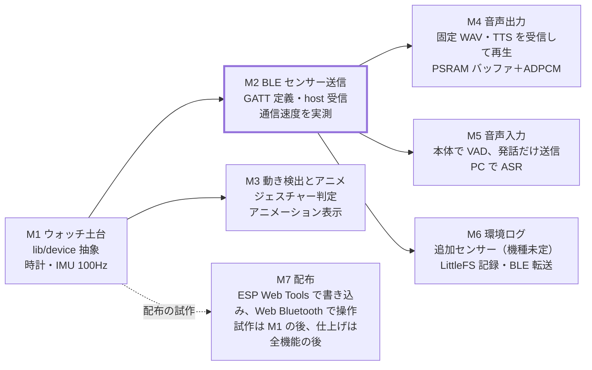

# M5Stack StickS3 ガジェット開発計画書

作成日: 2026-11-23

## 目的とスコープ

M5Stack StickS3 をベルトに付けるウォッチ型ガジェットにし、腕の動きと音声を PC と連携させる。
作ったファームは、技術に詳しくない人でもブラウザだけでインストールできる形で配布する。

| 機能 | 内容 | 通信 |
| --- | --- | --- |
| ウォッチ | 時計表示、ベルトアクセサリーとして常用 | なし |
| 動きの送信 | IMU（BMI270）で腕の動きを検出し、センサー値を PC に送る | BLE |
| グラフィック | 簡単なアニメーション表示 | なし |
| 音声出力 | PC で合成した TTS 音声や、本体に置いた固定 WAV をスピーカーで再生 | BLE（長い音声は WiFi も検討） |
| 音声入力 | 本体で VAD（発話区間の検出）を行い、発話だけを PC に送って ASR | BLE |
| 環境ログ | 追加センサーで環境情報を記録 | BLE / 本体保存 |
| 配布 | ブラウザからファームを書き込み、ブラウザから操作 | USB（Web Serial）/ BLE（Web Bluetooth） |

すべて A案（PlatformIO の Arduino ＋ M5Unified）で実装でき、スコープ外とする機能はない。

## 現状

開発環境とハードウェアの動作確認は 2026-11-23 に完了し、コミット `95041a4` に入っている。

| 項目 | 結果 |
| --- | --- |
| 開発環境 | Docker の `esp32_pio_container`（PlatformIO 6.2.0、esptool 5.6.0）。`./scripts/run_container.sh pio` で起動 |
| ビルド環境 | `espressif32@6.12.0`（Arduino-ESP32 2.0.17）、M5Unified 0.3.0、M5GFX 0.3.0（固定） |
| 工場出荷ファーム | UiFlow2 V2.4.8 を 8MB 全体吸い出し、2回読んで一致を確認。`projects/m5stick/backup/` に保存（git 管理外） |
| bringup | 表示、ボタン、IMU、スピーカー、マイク、シリアルすべて動作 |
| ボード判定 | `M5StickS3 (26)` |
| 描画性能 | 画面全体（240×135）のオフスクリーン描画で 29.4〜30.3 fps |
| IMU | 静止時の加速度の大きさ 0.99 g。bringup では画面更新と同じ 30Hz で読んでいる |
| 書き込み | 自作ファームが動いていれば `pio run -t upload` の自動リセットで書ける |

## 技術方針

ファームは1つの PlatformIO プロジェクトにアプリごとの env を並べ、ハードウェアはインターフェースの後ろに隠す。
アプリは M5Unified を直接呼ばず、`lib/device/` の抽象にだけ依存する（依存性逆転）。

```
projects/m5stick/
├── firmware/
│   ├── platformio.ini      # [env:bringup] [env:watch] ...
│   ├── src/<app>/main.cpp  # アプリごとのエントリ
│   ├── lib/device/         # IDisplay, IImu, IButtons, IAudioOut, IAudioIn, IPower と M5Unified 実装
│   ├── lib/ble/            # GATT サービス（センサー通知、音声転送、操作）
│   ├── lib/audio/          # ADPCM、VAD（ハード非依存、PC でテスト）
│   ├── lib/storage/        # LittleFS への記録
│   └── test/               # pio test -e native
├── host/                   # Python（bleak）で受信・ASR/TTS 連携・ログ保存
├── web/                    # ESP Web Tools（書き込み）＋ Web Bluetooth（操作）
└── tools/                  # バックアップ、配布用 bin の結合
```

- **ハード抽象**: color_led_cpp の `IRgbLed` と同じ考え方。ドライバの初期化はコンストラクタで行う（RAII）。
- **ハード非依存の処理**: ADPCM や VAD、ジェスチャー判定は `pio test -e native` で PC 上でテストする。
- **バージョン固定**: プラットフォームとライブラリはバージョンを固定し、更新は bringup で動作を確かめてから行う。
- **BLE プロトコル**: GATT の定義（UUID、パケット形式）は文書にしてファーム、`host/`、`web/` で共有する。

## マイルストーン

M1（ウォッチ土台）→ M2（BLE）の順に進め、腕の動きを PC に送る流れを最初に通す。
音声と環境ログは M2 で測った BLE の速度を見てから着手する。



矢印は依存関係を表す。日程は未定。
M3 は M1 だけに依存するので M2 と並行できる。
配布（M7）は M1 の後に試作して、初回書き込みの手順を早めに確かめる。

| マイルストーン | 成果物 | 完了条件 |
| --- | --- | --- |
| M1 ウォッチ土台 | `lib/device/`、`[env:watch]`、時計表示、IMU 取得タスク | IMU を 100Hz で欠落なく取得。時計が電源を入れ直しても正しい。消費電流を測定済み |
| M2 BLE センサー送信 | `lib/ble/`、GATT 定義書、`host/` の受信と CSV 保存 | 100Hz の IMU 値を PC で 1 時間受信し欠落 1% 未満。BLE の実効速度を記録 |
| M3 動き検出とアニメ | ジェスチャー判定（ハード非依存）、アニメーション表示 | 腕上げと腕振りを判定でき、native テストが通る。アニメーションが 30fps を保つ |
| M4 音声出力 | `lib/audio/` の ADPCM、固定 WAV（LittleFS）、TTS の受信と再生 | 固定 WAV を再生できる。PC の TTS 音声を受信して再生し、待ち時間を記録 |
| M5 音声入力 | VAD、発話の送信、`host/` の ASR 連携 | 発話区間だけが PC に届き、ASR が文字起こしを返す |
| M6 環境ログ | センサードライバ、LittleFS への記録、BLE での取り出し | 24 時間記録して PC に取り出せる |
| M7 配布 | `web/`（manifest、結合した bin）、手順ページ、公開先 | 開発に関わっていない人が、手順ページだけでインストールできる |

## ハードウェアの制約と設計上の注意

bringup でわかった制約は、どれもアプリの設計と配布手順に影響する。

| 制約 | 影響 | 対応 |
| --- | --- | --- |
| UiFlow2 動作中に esptool の自動リセットを受けると電源が落ちる | 初回の書き込みは自動ではできない | 配布手順に「電源ボタンを緑 LED が点滅するまで長押し」を図入りで書く |
| 手動でダウンロードモードに入ると、ソフトリセットでは抜けない | 書き込み後に起動しないように見える | 「書き込み後に電源ボタンを1回押す」を手順に入れる |
| USB は内蔵 USB-Serial/JTAG（`303a:1001`） | `lsusb` ではアプリ動作中かダウンロードモードか区別できない | 起動時にシリアルへバージョンを出す |
| M5Unified 0.3.0 は `Serial.begin()` を呼ばない | シリアル出力が黙って捨てられる | 各アプリの `setup()` で明示的に呼ぶ |
| マイクとスピーカーが ES8311 と I2S を共有 | 同時に録音と再生ができない（半二重） | 音声入出力を切り替える状態機械を `lib/device/` に置く。再生中は VAD を止める |
| IMU を画面更新と同じループで読むと 30Hz 止まり | 腕の動きの検出には少なすぎる | IMU を別タスクで 100〜200Hz で読み、リングバッファにためる |
| 電源は M5PM1 が管理（シングルクリックで起動、ダブルクリックで電源オフ） | ウォッチとしての電池持ちが課題 | 画面の消灯、スリープ、M5PM1 ライブラリの導入をウォッチで扱う |
| 電池駆動でスピーカー音量を 75% 以上にすると再起動することがある（M5Stack の注意書き） | 音声出力の音量に上限がある | 電池駆動時は音量を上限で抑える |

## リスクと未決事項

最大のリスクは音声を BLE で運ぶときの通信速度で、M4・M5 の前に M2 で実測して方式を決める。

| リスク | 影響 | 対策 |
| --- | --- | --- |
| BLE の実効速度が音声に足りない | 発話の送信や TTS の受信が遅れる | M2 で MTU と接続間隔を調整して実測。ADPCM で 1/4 に圧縮。足りなければ音声だけ WiFi（WebSocket） |
| 電池持ちがウォッチとして短い | 常用できない | M1 で消費電流を測り、画面消灯とスリープを入れる |
| Web Serial / Web Bluetooth は Chrome 系のみ対応 | Safari、Firefox、iPhone からは入れられない | 対応ブラウザを配布ページに明記し、非対応なら警告を出す |
| 初回は手動でダウンロードモードが必要 | 不慣れな人がつまずく | 配布ページに写真付きの手順を置き、初心者に試してもらう |
| Arduino-ESP32 2.0.17 は古い世代 | 将来の M5Unified が対応をやめる可能性 | バージョンを固定し、移行は bringup で確かめてから行う |

未決事項:

- [ ] 音声の通信方式（まず BLE だけで試すか、最初から WiFi も併用するか）
- [ ] 環境センサーの機種（Grove か Hat か、温湿度・気圧・CO2 など）
- [ ] PC 側の ASR / TTS エンジン（手元の ESPnet 環境を使うか）
- [ ] PC 側アプリの形態（Python の `host/` だけか、Web Bluetooth のページも一般利用者向けに作るか）
- [ ] 配布先（GitHub Pages で公開するか、限定公開か）
